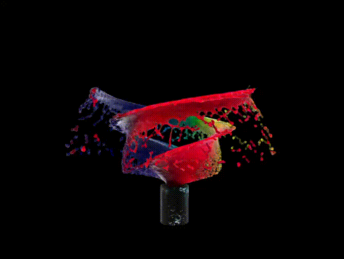

# gaussplats

This repo is a WebGPU implementation of the [Gaussian Splatting demo by Benjamin Feldman](https://bfeldman.me/3dgs-weekend/).



Instead of working with triangles as the drawing primitive, [Gaussian splats](https://en.wikipedia.org/wiki/Gaussian_splatting) are used. This demo uses PLY files as the input data for models created with these splats. The renderer reads this data, projects them onto the screen, then sorts and blends them to create the final image. There are fragment and vertex shaders perform most of the math to turn the splats into pixels.

## Usage

Clone and build the project. Requires the Zig version in the `build.zig.zon`.

```console
git clone https://github.com/braheezy/gaussplats
cd gaussplats
zig build
```

Then run with a PLY file, like those on [Supersplat](https://superspl.at/).

```console
./zig-out/bin/gaussplats meow.ply
```

## License

The demo has art by Stéphane Agullo, see license-paint.txt.

Everything else is MIT.
